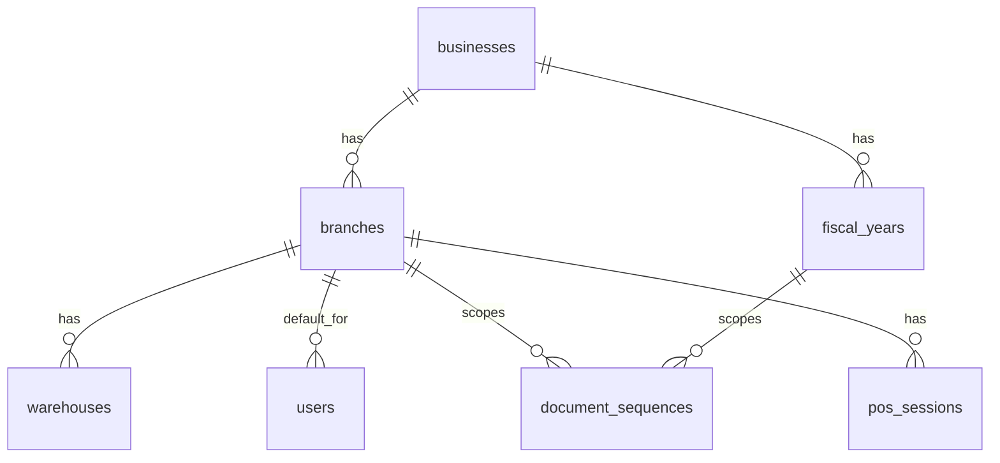
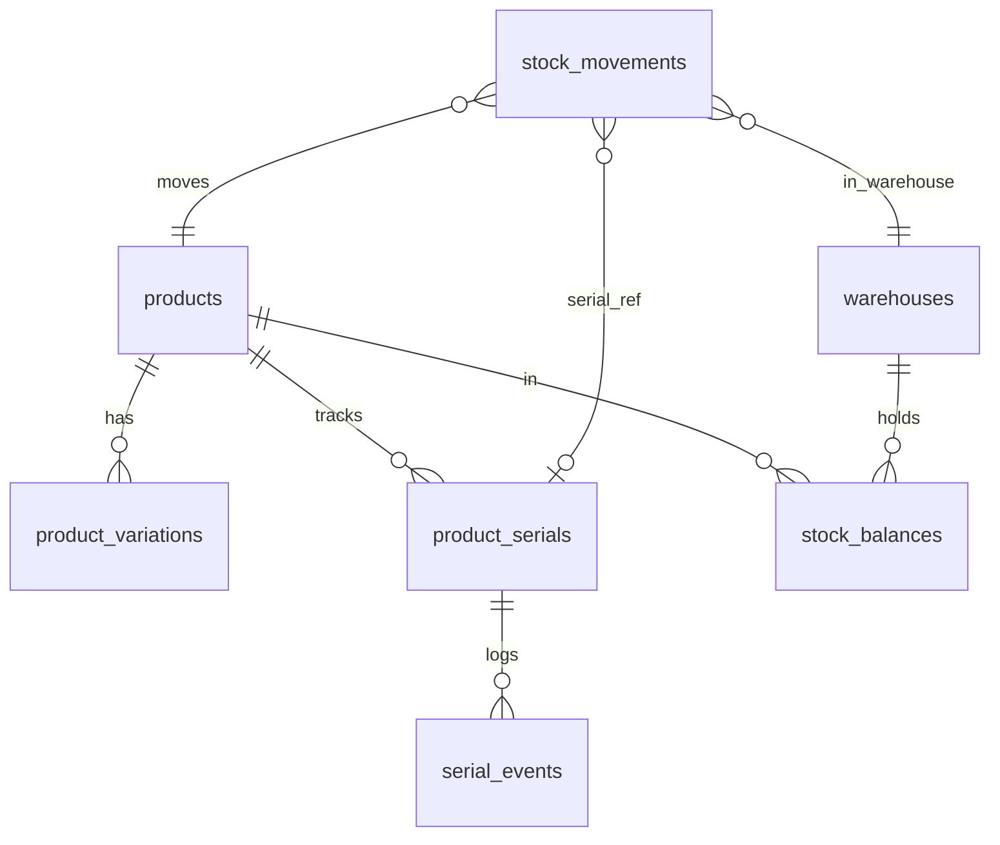
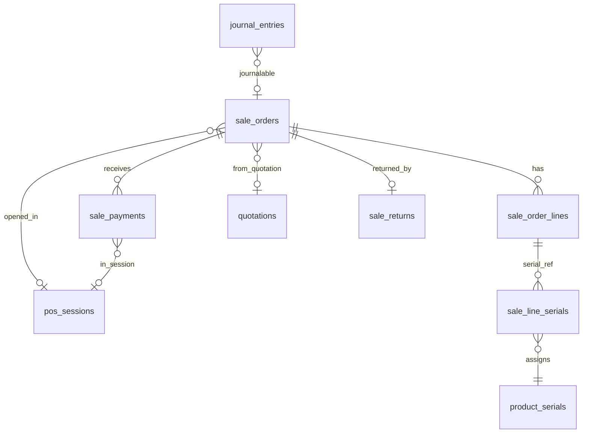
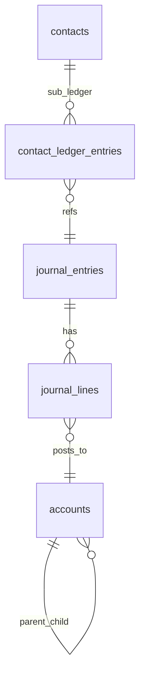

# تصميم قاعدة البيانات v3 — نظام ERP المحاسبي لمحل الجوالات والإلكترونيات

> **تاريخ الإنشاء:** 2026-10-21 | **آخر تحديث:** 2026-10-21 (v3)
> **المبدأ:** تصميم معماري فقط — ممنوع إنشاء migrations أو models قبل الموافقة.
> **محرك قاعدة البيانات:** MySQL 8.x / InnoDB، utf8mb4_unicode_ci.

---

## سجل القرارات المعمارية (ADR — Architecture Decision Records)

| # | القرار | البديل المرفوض | السبب |
|---|---|---|---|
| ADR-01 | حذف جدول `roles` — استخدام **spatie/laravel-permission** | جدول roles مخصص | Spatie يوفر RBAC كاملاً مع caching وintegration مع Sanctum. |
| ADR-02 | `tracking_type ENUM('none','serial')` بدلاً من `track_serial BOOLEAN` | boolean | قابل للتوسع (batch/lot) بدون تغيير الهيكل. |
| ADR-03 | **Sub-ledger** للعملاء/الموردين (AR=1130، AP=2100) + `contact_ledger_entries` | حساب منفصل لكل عميل | يُبقي دليل الحسابات نظيفاً؛ كشف الحساب الفردي من sub-ledger. |
| ADR-04 | **Polymorphic** `(journalable_type, journalable_id)` في `journal_entries` | journal_entry_id مكرر | مصدر واحد للحقيقة لكل المستندات. |
| ADR-05 | فصل quotations/sale_drafts/sale_returns/purchase_returns عن sales/purchases | ENUM type موحَّد | تقارير وصلاحيات وقيود محاسبية مختلفة جوهرياً. |
| ADR-06 | `paid_amount` مخزَّن مع اختبار تطابق | اشتقاق أو تخزين فقط | أداء POS وكشف المديونية؛ اختبار تطابق يضمن الصحة. |
| ADR-07 | `warehouses` مستقلة — stock_movements/stock_balances بـ warehouse_id | branch_id فقط | فرع قد يحوي عدة مخازن (معرض + خلفي + توزيع). |
| ADR-08 | `document_sequences` لكل (branch + fiscal_year + doc_type) | prefix+MAX(id) | منع تعارض الترقيم في الفروع المتعددة. |
| ADR-09 | sale_payments و purchase_payments **منفصلان** | جدول payments موحَّد | أبسط واستعلاماته أوضح. |
| ADR-10 | purchase_requests **مؤجلة** للمرحلة 2 | تنفيذ فوري | المحل لا يحتاجها في الإطلاق الأول؛ تُضاف دون تغيير الهيكل. |
| ADR-11 | `pos_sessions` من البداية (فتح/إغلاق الكاشير) | إضافة لاحقة | أصعب إضافتها لاحقاً لتداخلها مع sale_payments والخزينة. |
| ADR-12 | صلاحية الفرع: **Global Scope + branch_id** يُستثنى بصلاحية `branches.view_all` | فحص اسم الدور 'admin' | المرونة المعمارية وفصل الصلاحيات عن أسماء الأدوار الثابتة. |
| ADR-13 | **الريال السعودي فقط** في المرحلة الأولى؛ currencies منفذ ومؤجل المنطق، و exchange_rates مؤجل | multi-currency فوري | تبسيط التنفيذ؛ الهيكل يدعم إضافتها لاحقاً دون كسر. |
| ADR-14 | حالة السيريال **State Machine** — لا بيع لمسترجع إلا بعد دخوله المخزن | returned→sold مباشرة | ضبط دورة الحياة المخزنية ومنع البيع المباشر للأجهزة المرتجعة قبل فحصها واستلامها. |
| ADR-15 | UNIQUE على `imei1` و`imei2` و`serial_number` منفردةً (MySQL لا يدعم partial UNIQUE) | UNIQUE WHERE NOT NULL | UNIQUE القياسي في MySQL يسمح بقيم NULL متعددة (NULL != NULL). |
| ADR-16 | تكلفة السيريال محددة في `product_serials.cost_price` وتنتقل لسطر السيريال `sale_line_serials.cost_price` | دمجها في سطر الفاتورة | تباين تكلفة الأجهزة من نفس الصنف بالسيريال؛ سطر الفاتورة يحمل تكلفة الأصناف العادية فقط. |
| ADR-17 | مرتجع المبيعات يُعيد المخزون بتكلفة السطر الأصلي، لا المتوسط الحالي | المتوسط الحالي | يمنع اضطراب avg_cost عند الإرجاع ويحافظ على دقة COGS. |
| ADR-18 | الرصيد الافتتاحي للعميل/المورد يُحوَّل **تلقائياً** لقيد محاسبي | حقل مرجعي فقط | الميزانية الافتتاحية يجب أن تنعكس في دليل الحسابات من اليوم الأول. |
| ADR-19 | `source_quotation_id` فقط في sale_orders؛ حذف `converted_to_sale_id` من quotations | ربط دائري | الربط الدائري يُعقّد الهجرات وإضافة قيود FK. |
| ADR-20 | عمود مولّد `variation_key = COALESCE(variation_id, 0)` مع `UNIQUE` | UNIQUE مع NULL | MySQL يسمح بتكرار NULL في الفهارس الفريدة المركبة؛ العمود المولّد يضمن الفرادة التامة. |
| ADR-21 | السيريال المباع يحتفظ بآخر `warehouse_id` ولا يُصفَّر إلى NULL | تصفير warehouse_id | الحفاظ على بيانات مبيعات الفروع والمستودعات وسرعة التوجيه عند حدوث مرتجع مبيعات. |
| ADR-22 | إلغاء البيع المباشر للمرتجع `returned→sold` وإلزام دخوله المخزن، وإضافة `returned_to_supplier` | بيع المرتجع مباشرة | سلامة الدورة المخزنية وفحص الأجهزة المسترجعة وقبولها بصلاحية `serials.accept_return`. |
| ADR-23 | حركة مخزون منفردة `quantity=1` لكل جهاز بسيريال؛ المرجع الحاسم هو عدد سيريالات `in_stock` | حركة مجمعة للسيريالات | مطابقة حركة المخزون مع الأجهزة الفعلية بدقة وتجنب التباين في أرصدة الأصناف. |
| ADR-24 | نقل تكلفة السيريال الفعلية إلى `sale_line_serials.cost_price` ومرتجعه | تسجيلها في سطر الفاتورة | تفاوت تكلفة الأجهزة من نفس الصنف بالسيريال وتخصيص سطر الفاتورة للمنتجات العادية فقط. |
| ADR-25 | تكلفة التحويل المخزني: `transfer_out` بمتوسط المصدر ولا يغيره، و `transfer_in` يعيد حساب متوسط الوجهة | تغيير متوسط المصدر | خروج بضاعة بمتوسطها الحسابي لا يغير متوسط المتبقي ويحافظ على عدالة التكلفة. |
| ADR-26 | تقريب مبالغ قيود COGS لخانتين عشريتين مع ترحيل فروق الكسور | الترحيل بـ 4 خانات للقيد | معايير المحاسبة والقيود تتطلب خانتين عشريتين (قروش/هللات) لضمان توازن المدين والدائن. |

---

## القواعد المعمارية الصارمة

| القاعدة | التفاصيل |
|---|---|
| **المبالغ والكميات** | `DECIMAL(18,4)` — لا FLOAT أو DOUBLE |
| **تقريب القيود (COGS)** | تُقرَّب مبالغ قيود اليومية لخانتين عشريتين (`ROUND(2)`) وتُرحَّل فروق الكسور لضمان توازن القيد |
| **رصيد الحساب** | يُحسب من journal_lines — لا يُخزَّن |
| **رصيد المخزون** | stock_balances يُحدَّث في نفس Transaction مع stock_movements |
| **مرجع السيريال** | لمنتجات السيريال حركة واحدة لكل جهاز (`qty=1` و `serial_id` مملوء). المرجع عند الاختلاف هو عدد السيريالات `in_stock` |
| **القيد المرحّل** | posted — لا يُعدَّل ولا يُحذف؛ التصحيح بقيد عكسي |
| **المخزون السالب** | ممنوع — يُتحقق من stock_balances >= qty FOR UPDATE قبل sale_out |
| **المنتجات المتغيرة** | نوع `variable` لا يُباع ولا يُشترى إلا بتحديد `variation_id` إجبارياً |
| **شجرة الأصناف** | منع الحلقات الدائرية في `product_categories` (الصنف لا يكون أباً لنفسه ولا لنسله) |
| **المعاملة الذرية** | مخزون + stock_balance + قيد في Transaction واحدة |
| **SoftDeletes** | contacts, products, sale_orders, purchase_orders, expenses, vouchers |
| **العملة** | ريال سعودي فقط (المرحلة 1) — currencies منفذ ومؤجل المنطق، ولا exchange_rates |
| **عزل الفرع** | Global Scope يُضيف WHERE branch_id = auth()->user()->branch_id ويُستثنى من يملك `branches.view_all` |

---

## القسم الأول: إدارة النظام

### 1.1 جدول `businesses`

```
businesses
├── id                     BIGINT UNSIGNED PK
├── name                   VARCHAR(191) NOT NULL
├── name_en                VARCHAR(191) NULL
├── logo                   VARCHAR(500) NULL
├── address                TEXT NULL
├── phone                  VARCHAR(30) NULL
├── email                  VARCHAR(191) NULL
├── tax_number             VARCHAR(50) NULL
├── commercial_register    VARCHAR(50) NULL
├── decimal_places         TINYINT DEFAULT 2
├── created_at, updated_at TIMESTAMPS
```

### 1.2 جدول `fiscal_years` — السنوات المالية

```
fiscal_years
├── id             BIGINT UNSIGNED PK
├── business_id    BIGINT UNSIGNED FK→businesses.id
├── name           VARCHAR(100) NOT NULL
├── start_date     DATE NOT NULL
├── end_date       DATE NOT NULL
├── status         ENUM('open','closed') DEFAULT 'open'
├── closed_at      TIMESTAMP NULL
├── closed_by      BIGINT UNSIGNED FK→users.id NULL
├── created_at, updated_at TIMESTAMPS
-- UNIQUE(business_id, start_date)
-- قاعدة: لا مستند مالي في fiscal_year مغلقة
```

### 1.3 جدول `branches`

```
branches
├── id           BIGINT UNSIGNED PK
├── business_id  BIGINT UNSIGNED FK→businesses.id
├── name         VARCHAR(191) NOT NULL
├── code         VARCHAR(20) UNIQUE NOT NULL
├── address      TEXT NULL
├── phone        VARCHAR(30) NULL
├── is_active    BOOLEAN DEFAULT true
├── created_at, updated_at TIMESTAMPS
```

### 1.4 جدول `warehouses` — المخازن (مخزن أو أكثر لكل فرع)

```
warehouses
├── id         BIGINT UNSIGNED PK
├── branch_id  BIGINT UNSIGNED FK→branches.id
├── name       VARCHAR(191) NOT NULL
├── code       VARCHAR(20) UNIQUE NOT NULL
├── is_default BOOLEAN DEFAULT false   -- مخزن افتراضي للفرع
├── is_active  BOOLEAN DEFAULT true
├── created_at, updated_at TIMESTAMPS
-- INDEX(branch_id)
```

### 1.5 جدول `users` (Spatie Permissions — ADR-01)

```
users
├── id             BIGINT UNSIGNED PK
├── name           VARCHAR(191) NOT NULL
├── email          VARCHAR(191) UNIQUE NOT NULL
├── password       VARCHAR(255) NOT NULL
├── branch_id      BIGINT UNSIGNED FK→branches.id NULL  -- الفرع الافتراضي للعزل
├── is_active      BOOLEAN DEFAULT true
├── remember_token VARCHAR(100) NULL
├── created_at, updated_at TIMESTAMPS
├── deleted_at     TIMESTAMP NULL
-- جداول Spatie التلقائية: roles, permissions,
-- model_has_roles, model_has_permissions, role_has_permissions
```

**عزل بيانات الفرع (ADR-12):**
```
كل Model عملياتي يُطبّق Global Scope (BranchScope):
  protected static function booted(): void {
      static::addGlobalScope('branch', function($q) {
          if (auth()->check() && !auth()->user()->can('branches.view_all')) {
              $q->where('branch_id', auth()->user()->branch_id);
          }
      });
  }

الجداول التي تحمل branch_id (وتخضع لـ Global Scope):
  sale_orders, purchase_orders, sale_returns, purchase_returns,
  sale_drafts, quotations, expenses, vouchers, checks, bank_transfers,
  inventory_transfers, stock_adjustments, damaged_stock,
  opening_stocks, pos_sessions
```

### 1.6 جدول `representatives`

```
representatives
├── id              BIGINT UNSIGNED PK
├── user_id         BIGINT UNSIGNED FK→users.id NULL
├── name            VARCHAR(191) NOT NULL
├── phone           VARCHAR(30) NULL
├── commission_rate DECIMAL(5,2) DEFAULT 0
├── is_active       BOOLEAN DEFAULT true
├── created_at, updated_at TIMESTAMPS
```

### 1.7 جدول `document_sequences`

```
document_sequences
├── id             BIGINT UNSIGNED PK
├── branch_id      BIGINT UNSIGNED FK→branches.id
├── fiscal_year_id BIGINT UNSIGNED FK→fiscal_years.id
├── doc_type       VARCHAR(50) NOT NULL
--   ('sale_invoice','sale_return','sale_draft','quotation',
--    'purchase','purchase_return','journal_entry',
--    'voucher_payment','voucher_receipt','check',
--    'bank_transfer','stock_adjustment','transfer','pos_session')
├── prefix         VARCHAR(10) NOT NULL
├── last_number    INT UNSIGNED DEFAULT 0
├── padding        TINYINT DEFAULT 5
├── created_at, updated_at TIMESTAMPS
-- UNIQUE(branch_id, fiscal_year_id, doc_type)
-- يُستخدم مع SELECT FOR UPDATE لمنع تعارض الترقيم
```

### 1.8 جدول `pos_sessions` — جلسات نقطة البيع (ADR-11)

```
pos_sessions
├── id                   BIGINT UNSIGNED PK
├── session_number       VARCHAR(30) UNIQUE NOT NULL
├── branch_id            BIGINT UNSIGNED FK→branches.id
├── warehouse_id         BIGINT UNSIGNED FK→warehouses.id
├── treasury_id          BIGINT UNSIGNED FK→treasuries.id
├── user_id              BIGINT UNSIGNED FK→users.id     -- الكاشير
├── fiscal_year_id       BIGINT UNSIGNED FK→fiscal_years.id
├── opened_at            TIMESTAMP NOT NULL
├── closed_at            TIMESTAMP NULL
├── opening_balance      DECIMAL(18,4) DEFAULT 0         -- رصيد بداية الصندوق
├── expected_closing     DECIMAL(18,4) DEFAULT 0         -- المتوقع (محسوب)
├── actual_closing       DECIMAL(18,4) NULL               -- المعدود فعلياً
├── difference           DECIMAL(18,4) NULL               -- actual - expected
├── status               ENUM('open','closed') DEFAULT 'open'
├── notes                TEXT NULL
├── created_at, updated_at TIMESTAMPS
-- INDEX(branch_id, status), INDEX(user_id)
-- قاعدة: كاشير لا يمكنه فتح جلسة جديدة قبل إغلاق السابقة
```

**ربط pos_sessions بالمستندات:**
```
sale_orders.pos_session_id  FK→pos_sessions.id NULL
sale_payments.pos_session_id FK→pos_sessions.id NULL

expected_closing = opening_balance
  + SUM(sale_payments.amount WHERE payment_method.type='cash' AND pos_session_id=?)
  - SUM(expenses.amount WHERE treasury_id=? AND date=session_date)
```

---

## القسم الثاني: البيانات الأساسية (Master Data)

> **ADR-13:** لا currency_id ولا exchange_rate في الفواتير (مرحلة 1). جدول `currencies` مُنفَّذ في المرحلة أ بسجل افتراضي وحيد (الريال السعودي SAR)، ومنطق تعدد العملات وجدول `exchange_rates` مؤجلان.

### 2.1 `currencies` [منفذ في المرحلة أ — مؤجل المنطق — ADR-13]

```
currencies [منفذ — سجل افتراضي SAR]
├── id, name, code VARCHAR(10) UNIQUE, symbol VARCHAR(10)
├── is_default BOOLEAN, is_active BOOLEAN, created_at, updated_at
```

### 2.2 `exchange_rates` [مؤجل — ADR-13]

```
exchange_rates [مؤجل]
├── id, from_currency_id, to_currency_id, rate DECIMAL(18,4)
├── date DATE, created_by FK→users.id, created_at
-- UNIQUE(from_currency_id, to_currency_id, date)
```

### 2.3 جدول `taxes`

```
taxes
├── id         BIGINT UNSIGNED PK
├── name       VARCHAR(100) NOT NULL
├── rate       DECIMAL(5,2) NOT NULL   -- 15.00
├── type       ENUM('percentage','fixed') DEFAULT 'percentage'
├── tax_type   ENUM('vat_output','vat_input','other') DEFAULT 'vat_output'
├── account_id BIGINT UNSIGNED FK→accounts.id NULL  -- حساب الضريبة
├── is_active  BOOLEAN DEFAULT true
├── created_at, updated_at TIMESTAMPS
```

### 2.4 جدول `payment_methods` — طرق الدفع (ADR-09)

```
payment_methods
├── id         BIGINT UNSIGNED PK
├── name       VARCHAR(100) NOT NULL   -- نقدي، شبكة، تحويل، آجل
├── type       ENUM('cash','bank','network','check','credit','other') NOT NULL
├── account_id BIGINT UNSIGNED FK→accounts.id
--             cash → حساب الخزينة | bank → حساب البنك | network → حساب الشبكة
├── is_active  BOOLEAN DEFAULT true
├── created_at, updated_at TIMESTAMPS

التفريق بين الصندوق/البنك/الشبكة:
  type='cash'    → account_id يشير لحساب خزينة (1111)
  type='bank'    → account_id يشير لحساب بنك (1121)
  type='network' → account_id يشير لحساب شبكة (1131)
  type='credit'  → لا يُنشئ حركة نقدية فورية (يُضاف للذمم)
```

### 2.5 جدول `treasuries`

```
treasuries
├── id, branch_id FK→branches.id
├── name VARCHAR(100) NOT NULL
├── account_id FK→accounts.id   -- حساب الخزينة في دليل الحسابات
├── is_default BOOLEAN DEFAULT false
├── is_active  BOOLEAN DEFAULT true
├── created_at, updated_at TIMESTAMPS
```

### 2.6 جدول `bank_accounts`

```
bank_accounts
├── id, branch_id FK→branches.id
├── bank_name VARCHAR(191), account_number VARCHAR(50), iban VARCHAR(34) NULL
├── account_id FK→accounts.id   -- حساب البنك في دليل الحسابات
├── is_active BOOLEAN DEFAULT true, created_at, updated_at TIMESTAMPS
```

### 2.7 `shipping_companies` | `selling_price_groups`

```
shipping_companies: id, name, phone NULL, is_active, timestamps
selling_price_groups: id, name, description TEXT NULL, is_active, timestamps
```

---

## القسم الثالث: جهات الاتصال

### 3.1 `contact_groups`

```
contact_groups
├── id, name VARCHAR(191) NOT NULL
├── type ENUM('customer','supplier','both') NOT NULL
├── discount_percent DECIMAL(5,2) DEFAULT 0
├── selling_price_group_id FK→selling_price_groups.id NULL
├── created_at, updated_at TIMESTAMPS
```

### 3.2 جدول `contacts` (ADR-03)

```
contacts
├── id                     BIGINT UNSIGNED PK
├── type                   ENUM('customer','supplier','both') NOT NULL
├── name                   VARCHAR(191) NOT NULL
├── code                   VARCHAR(50) UNIQUE NULL
├── phone                  VARCHAR(30) NULL
├── phone_alt              VARCHAR(30) NULL
├── email                  VARCHAR(191) NULL
├── address                TEXT NULL
├── tax_number             VARCHAR(50) NULL
├── contact_group_id       BIGINT UNSIGNED FK→contact_groups.id NULL
├── representative_id      BIGINT UNSIGNED FK→representatives.id NULL
├── selling_price_group_id BIGINT UNSIGNED FK→selling_price_groups.id NULL
├── credit_limit           DECIMAL(18,4) DEFAULT 0
├── opening_balance        DECIMAL(18,4) DEFAULT 0
├── opening_balance_type   ENUM('debit','credit') NULL
├── is_active              BOOLEAN DEFAULT true
├── notes                  TEXT NULL
├── created_at, updated_at TIMESTAMPS
├── deleted_at             TIMESTAMP NULL
-- INDEX(type, contact_group_id)
```

**الرصيد الافتتاحي (ADR-18):**
```
عند حفظ contact مع opening_balance > 0، يُنشأ تلقائياً:
  journal_entry (journalable_type='Contact', journalable_id=contact.id, status='posted')
    └── journal_line: حساب AR (1130) debit = opening_balance  [إذا العميل]
    └── journal_line: حساب أرصدة افتتاحية (3500) credit = opening_balance
  أو:
    └── journal_line: حساب AP (2100) credit = opening_balance  [إذا المورد]
    └── journal_line: حساب أرصدة افتتاحية (3500) debit = opening_balance

حساب 3500 "أرصدة افتتاحية" — is_system=true، يُصفَّر عند إقفال السنة.
```

### 3.3 جدول `contact_ledger_entries` — Sub-Ledger (ADR-03)

```
contact_ledger_entries
├── id               BIGINT UNSIGNED PK
├── contact_id       BIGINT UNSIGNED FK→contacts.id
├── journal_entry_id BIGINT UNSIGNED FK→journal_entries.id
├── fiscal_year_id   BIGINT UNSIGNED FK→fiscal_years.id   ← مضاف (إصلاح #5)
├── date             DATE NOT NULL
├── debit            DECIMAL(18,4) DEFAULT 0
├── credit           DECIMAL(18,4) DEFAULT 0
├── reference_type   VARCHAR(50) NULL
├── reference_id     BIGINT UNSIGNED NULL
├── description      TEXT NULL
├── created_at       TIMESTAMP
-- INDEX(contact_id, date, fiscal_year_id)

اختبار تطابق sub-ledger (إصلاح #5):
  -- العملاء:
  SUM(cle.debit - cle.credit) WHERE contact.type IN ('customer','both')
    MUST EQUAL
  SUM(jl.debit - jl.credit) WHERE jl.account_id = 1130 (AR)

  -- الموردون:
  SUM(cle.credit - cle.debit) WHERE contact.type IN ('supplier','both')
    MUST EQUAL
  SUM(jl.credit - jl.debit) WHERE jl.account_id = 2100 (AP)
```

---

## القسم الرابع: المنتجات والأصناف

### 4.1-4.4 الجداول المساعدة

```
product_categories: id, parent_id NULL (self-ref), name, code NULL, is_active, timestamps
-- قاعدة شجرة الأصناف: منع الحلقات الدائرية (parent_id != id، ويُمنع اختيار أي سليل descendant كأب عبر CategoryHierarchyRule).
brands:             id, name, logo NULL, is_active, timestamps
units:              id, name, short_name, base_unit_id NULL (self-ref), conversion_factor DECIMAL(18,4), is_active, timestamps
warranties:         id, name, duration_months SMALLINT, description NULL, is_active, timestamps
```

### 4.5 جدول `products` (ADR-02)

```
products
├── id                   BIGINT UNSIGNED PK
├── type                 ENUM('single','variable','service') DEFAULT 'single'
├── name                 VARCHAR(191) NOT NULL
├── sku                  VARCHAR(100) UNIQUE NOT NULL
├── barcode              VARCHAR(100) NULL
├── category_id          BIGINT UNSIGNED FK→product_categories.id NULL
├── brand_id             BIGINT UNSIGNED FK→brands.id NULL
├── unit_id              BIGINT UNSIGNED FK→units.id NOT NULL
├── purchase_unit_id     BIGINT UNSIGNED FK→units.id NULL
├── warranty_id          BIGINT UNSIGNED FK→warranties.id NULL
├── tracking_type        ENUM('none','serial') DEFAULT 'none'   [ADR-02]
├── has_expiry           BOOLEAN DEFAULT false
├── cost_price           DECIMAL(18,4) DEFAULT 0   -- مرجعي للـ none فقط
├── selling_price        DECIMAL(18,4) DEFAULT 0
├── min_selling_price    DECIMAL(18,4) DEFAULT 0
├── reorder_level        DECIMAL(18,4) DEFAULT 0
├── tax_id               BIGINT UNSIGNED FK→taxes.id NULL
├── income_account_id    BIGINT UNSIGNED FK→accounts.id NULL
├── cogs_account_id      BIGINT UNSIGNED FK→accounts.id NULL
├── inventory_account_id BIGINT UNSIGNED FK→accounts.id NULL
├── description          TEXT NULL
├── image                VARCHAR(500) NULL
├── is_active            BOOLEAN DEFAULT true
├── created_at, updated_at TIMESTAMPS
├── deleted_at           TIMESTAMP NULL
-- INDEX(sku), INDEX(barcode), INDEX(category_id, brand_id, tracking_type)
-- قاعدة: المنتج المتغير (type='variable') لا يُباع ولا يُشترى بدون تحديد variation_id إجبارياً
-- (رمي VariableProductRequiresVariationException).
```

### 4.6 `product_variations`

```
product_variations
├── id, product_id FK→products.id CASCADE DELETE
├── name VARCHAR(191), sku VARCHAR(100) UNIQUE, barcode VARCHAR(100) NULL
├── cost_price, selling_price DECIMAL(18,4)
├── image NULL, is_active BOOLEAN, created_at, updated_at TIMESTAMPS
```

### 4.7 `product_price_group_prices`

```
product_price_group_prices
├── id, product_id FK→products.id, variation_id NULL FK→product_variations.id
├── variation_key BIGINT UNSIGNED GENERATED ALWAYS AS (COALESCE(variation_id, 0)) STORED [ADR-20]
├── selling_price_group_id FK→selling_price_groups.id
├── price DECIMAL(18,4) NOT NULL, created_at, updated_at TIMESTAMPS
-- UNIQUE(product_id, selling_price_group_id, variation_key) [ADR-20 — يمنع تكرار السعر مع NULL]
```

### 4.8 جدول `product_serials` — IMEI/Serial (ADR-14, ADR-15, ADR-16)

```
product_serials
├── id            BIGINT UNSIGNED PK
├── product_id    BIGINT UNSIGNED FK→products.id
├── variation_id  BIGINT UNSIGNED FK→product_variations.id NULL
├── serial_number VARCHAR(100) NOT NULL
├── imei1         VARCHAR(20) NULL    [UNIQUE — MySQL يسمح بـ NULL متعددة]
├── imei2         VARCHAR(20) NULL    [UNIQUE — MySQL يسمح بـ NULL متعددة]
├── status        ENUM('in_stock','sold','returned','damaged','transferred','returned_to_supplier') DEFAULT 'in_stock'
├── warehouse_id  BIGINT UNSIGNED FK→warehouses.id NOT NULL
├── cost_price    DECIMAL(18,4) DEFAULT 0   [ADR-16: تكلفة فعلية محددة من فاتورة الشراء]
├── notes         TEXT NULL
├── created_at, updated_at TIMESTAMPS

-- UNIQUE(serial_number)          ← فريد عالمياً (إصلاح #2)
-- UNIQUE(imei1)                  ← فريد عالمياً (إصلاح #2، MySQL لا يدعم PARTIAL UNIQUE)
-- UNIQUE(imei2)                  ← فريد عالمياً (إصلاح #2)
-- INDEX(status, warehouse_id, product_id)

ملاحظات معمارية:
1. UNIQUE(serial_number) فريد عالمياً بطبيعته (IMEI مثلاً).
2. السيريال المباع (status='sold') يحتفظ بآخر warehouse_id تواجد به (ممنوع تصفيره لـ NULL)
   لأغراض تقارير مبيعات الفروع/المستودعات وسرعة التوجيه عند حدوث مرتجع لاحقاً.
```

**تكلفة المخزون (ADR-16):**
```
tracking_type = 'serial' → التكلفة = product_serials.cost_price (فعلية محددة لكل جهاز وتنتقل لسطر البيع)
tracking_type = 'none'   → التكلفة = stock_balances.avg_cost (المتوسط المرجح)
لا FIFO.
```

### 4.9 State Machine حالات السيريال (ADR-14)

| من | إلى | الحدث | الشرط والصلاحية |
|---|---|---|---|
| in_stock | sold | بيع مؤكَّد | status = 'in_stock' |
| in_stock | damaged | تسجيل تالف | status = 'in_stock' |
| in_stock | transferred | تحويل مخزون (قيد النقل) | status = 'in_stock' |
| in_stock | returned_to_supplier | مرتجع مشتريات لمورد | status = 'in_stock' |
| sold | returned | مرتجع مبيعات من عميل | status = 'sold' (يخضع للفحص الأولي) |
| returned | in_stock | قبول المرتجع وإدخاله المخزن | status = 'returned' + صلاحية `serials.accept_return` (أمين المستودع/المشرف) |
| returned | returned_to_supplier | إرجاع جهاز معيب لمورد | status = 'returned' (مرتجع مشتريات لعيب مصنعي) |
| transferred | in_stock | استلام التحويل بالمستودع الوجهة | status = 'transferred' |
| damaged | — | تالف نهائي (Scrap) | نهاية دورة الحياة (تحميل خسارة 5300) |
| damaged | in_stock | إعادة تأهيل / إصلاح معتمد | status = 'damaged' + إذن تسوية مخزنية إضافة معتمد (adjustment_in) |

> **قواعد State Machine والصلاحيات:**
> 1. **إلغاء البيع المباشر للمرتجع:** أُلغي الانتقال المباشر `returned → sold`. الجهاز المرتجع يجب أن يُفحص ويقبله أمين المستودع رسمياً ليعود رصيداً متاحاً في المستودع (`returned → in_stock`)، وفقط بعد ذلك يمكن بيعه مجدداً (`in_stock → sold`).
> 2. **صلاحية قبول المرتجع:** لا يستطيع الكاشير العادي إدخال الجهاز المرتجع مباشرة للمخزن؛ بل تتطلب العملية صلاحية صريحة: `serials.accept_return` (تُمنح لأمين المستودع ومدير النظام).
> 3. **مصير التالف (`damaged`):** هو خروج نهائي افتراضياً (Scrap)، ولكن يُسمح بالانتقال `damaged → in_stock` حصراً في حال إعادة تأهيله أو صيانته، وذلك بموجب إذن تسوية مخزنية إضافة معتمد (`stock_adjustments: adjustment_in`).
> 4. **مرتجع المورد (`returned_to_supplier`):** خروج نهائي للجهاز من عهدة المؤسسة للمورد.

**منع البيع بحالة غير صحيحة (داخل Transaction):**
```sql
BEGIN;
  SELECT status FROM product_serials WHERE id = ? FOR UPDATE;
  -- إذا status != 'in_stock' → ROLLBACK + throw InvalidSerialStatusException
  -- إذا status = 'in_stock' → متابعة البيع وتحديث status = 'sold'
COMMIT;
```

> **ADR-14:** لا UNIQUE على sale_line_serials أو purchase_line_serials.
> الجهاز يمكن أن يُباع ويُرجَّع ويُباع مجدداً. التحكم عبر State Machine فقط.

### 4.10 جدول `serial_events` — سجل كامل لحياة السيريال

```
serial_events
├── id                BIGINT UNSIGNED PK
├── serial_id         BIGINT UNSIGNED FK→product_serials.id
├── event_type        ENUM('purchased','transferred','sold','returned','damaged','adjusted') NOT NULL
├── from_warehouse_id BIGINT UNSIGNED FK→warehouses.id NULL
├── to_warehouse_id   BIGINT UNSIGNED FK→warehouses.id NULL
├── from_status       VARCHAR(20) NOT NULL
├── to_status         VARCHAR(20) NOT NULL
├── reference_type    VARCHAR(50) NULL
├── reference_id      BIGINT UNSIGNED NULL
├── unit_cost         DECIMAL(18,4) NULL
├── unit_price        DECIMAL(18,4) NULL
├── notes             TEXT NULL
├── created_by        BIGINT UNSIGNED FK→users.id
├── created_at        TIMESTAMP NOT NULL
-- INDEX(serial_id, created_at), INDEX(reference_type, reference_id)
```

---

## القسم الخامس: دليل الحسابات والقيود

### 5.1 جدول `accounts`

```
accounts
├── id          BIGINT UNSIGNED PK
├── parent_id   BIGINT UNSIGNED FK→accounts.id NULL
├── code        VARCHAR(20) UNIQUE NOT NULL
├── name        VARCHAR(191) NOT NULL
├── type        ENUM('asset','liability','equity','revenue','expense') NOT NULL
├── level       TINYINT UNSIGNED DEFAULT 1   -- 1..5
├── is_header   BOOLEAN DEFAULT false         -- لا يُرحَّل عليه مباشرة
├── description TEXT NULL
├── is_active   BOOLEAN DEFAULT true
├── is_system   BOOLEAN DEFAULT false         -- لا يُحذف ولا يُغيَّر كوده
├── created_at, updated_at TIMESTAMPS
-- INDEX(parent_id, type, code)
```

**الحسابات النظامية (is_system=true):**
```
1111 الصندوق الرئيسي (cash)
1121 البنك الرئيسي (bank)
1131 شبكة الدفع (network)
1130 الذمم المدينة AR      [مجمَّع — ADR-03]
1140 المخزون
1150 ضريبة مدخلات
1XXX أوراق قبض (شيكات واردة)
2100 الذمم الدائنة AP      [مجمَّع — ADR-03]
2200 ضريبة مخرجات مستحقة
2XXX أوراق دفع (شيكات صادرة)
3500 أرصدة افتتاحية        [ADR-18 — يُصفَّر عند إقفال السنة]
4100 إيرادات المبيعات
4200 إيرادات أخرى
5100 تكلفة البضاعة المباعة (COGS)
5300 خسارة مخزون تالف/جرد
5400 مصروف شيكات مرتجعة   [is_system=true — إصلاح #7]
52XX مصاريف تشغيلية
```

### 5.2 جدول `journal_entries` (ADR-04)

```
journal_entries
├── id               BIGINT UNSIGNED PK
├── entry_number     VARCHAR(30) UNIQUE NOT NULL
├── journalable_type VARCHAR(50) NULL   -- 'SaleOrder','PurchaseOrder','Voucher'...
├── journalable_id   BIGINT UNSIGNED NULL
├── date             DATE NOT NULL
├── fiscal_year_id   BIGINT UNSIGNED FK→fiscal_years.id
├── description      TEXT NULL
├── status           ENUM('draft','posted') DEFAULT 'draft'
├── posted_at        TIMESTAMP NULL
├── branch_id        BIGINT UNSIGNED FK→branches.id NULL
├── created_by       BIGINT UNSIGNED FK→users.id
├── posted_by        BIGINT UNSIGNED FK→users.id NULL
├── created_at, updated_at TIMESTAMPS
-- INDEX(journalable_type, journalable_id), INDEX(date, status, fiscal_year_id)
-- قاعدة: لا قيد في fiscal_year مغلقة
```

### 5.3 جدول `journal_lines`

```
journal_lines
├── id               BIGINT UNSIGNED PK
├── journal_entry_id BIGINT UNSIGNED FK→journal_entries.id CASCADE DELETE
├── account_id       BIGINT UNSIGNED FK→accounts.id
├── description      TEXT NULL
├── debit            DECIMAL(18,4) DEFAULT 0
├── credit           DECIMAL(18,4) DEFAULT 0
├── created_at       TIMESTAMP
-- INDEX(journal_entry_id, account_id)
-- CHECK: debit >= 0, credit >= 0
-- CHECK: NOT(debit > 0 AND credit > 0) في نفس السطر
-- Validation (PHP): SUM(debit) = SUM(credit) قبل الترحيل
```

---

## القسم السادس: المبيعات (ADR-05)

### 6.1 `quotations` + `quotation_lines` (ADR-19)

```
quotations
├── id, quotation_number VARCHAR(30) UNIQUE, date DATE, expiry_date DATE NULL
├── fiscal_year_id FK→fiscal_years.id
├── contact_id NULL FK→contacts.id, branch_id, warehouse_id NULL, user_id
├── subtotal, discount_amount, tax_amount, total_amount DECIMAL(18,4)
├── status ENUM('draft','sent','accepted','rejected','expired') DEFAULT 'draft'
├── notes TEXT NULL, created_at, updated_at TIMESTAMPS
-- لا converted_to_sale_id هنا (ADR-19 — حذف الربط الدائري)

quotation_lines
├── id, quotation_id FK→quotations.id CASCADE DELETE
├── product_id, variation_id NULL, quantity DECIMAL(18,4), unit_id
├── unit_price, discount_amount, tax_amount, total_amount DECIMAL(18,4)
├── notes NULL, created_at TIMESTAMP
```

### 6.2 `sale_drafts` + `sale_draft_lines`

```
sale_drafts
├── id, draft_number VARCHAR(30) UNIQUE, date DATE, fiscal_year_id
├── contact_id NULL, branch_id, warehouse_id, user_id
├── subtotal, discount_amount, tax_amount, total_amount DECIMAL(18,4)
├── notes NULL, created_at, updated_at TIMESTAMPS
-- لا قيد ولا حركة مخزون

sale_draft_lines
├── id, sale_draft_id CASCADE DELETE, product_id, variation_id NULL
├── quantity, unit_id, unit_price, total_amount DECIMAL(18,4), created_at
```

### 6.3 جدول `sale_orders` — فواتير المبيعات

```
sale_orders
├── id                   BIGINT UNSIGNED PK
├── order_number         VARCHAR(30) UNIQUE NOT NULL
├── date                 DATE NOT NULL
├── fiscal_year_id       BIGINT UNSIGNED FK→fiscal_years.id
├── pos_session_id       BIGINT UNSIGNED FK→pos_sessions.id NULL   [ربط POS]
├── contact_id           BIGINT UNSIGNED FK→contacts.id NULL
├── branch_id            BIGINT UNSIGNED FK→branches.id NOT NULL
├── warehouse_id         BIGINT UNSIGNED FK→warehouses.id NOT NULL
├── user_id              BIGINT UNSIGNED FK→users.id
├── representative_id    BIGINT UNSIGNED FK→representatives.id NULL
├── shipping_company_id  BIGINT UNSIGNED FK→shipping_companies.id NULL
├── discount_id          BIGINT UNSIGNED FK→discounts.id NULL       [إصلاح #9]
├── subtotal             DECIMAL(18,4) DEFAULT 0
├── discount_type        ENUM('percentage','fixed','from_table') NULL
├── discount_value       DECIMAL(18,4) DEFAULT 0
├── discount_amount      DECIMAL(18,4) DEFAULT 0
├── tax_amount           DECIMAL(18,4) DEFAULT 0
├── shipping_amount      DECIMAL(18,4) DEFAULT 0
├── total_amount         DECIMAL(18,4) DEFAULT 0
├── paid_amount          DECIMAL(18,4) DEFAULT 0   [ADR-06]
├── payment_status       ENUM('unpaid','partial','paid') DEFAULT 'unpaid'
├── status               ENUM('confirmed','shipped','completed','cancelled') DEFAULT 'confirmed'
├── source_draft_id      BIGINT UNSIGNED FK→sale_drafts.id NULL
├── source_quotation_id  BIGINT UNSIGNED FK→quotations.id NULL      [ADR-19]
├── -- ZATCA (حقول فقط — منطق مؤجل):
├── zatca_uuid           CHAR(36) NULL
├── invoice_hash         VARCHAR(64) NULL
├── qr_code              TEXT NULL
├── zatca_status         ENUM('pending','submitted','accepted','rejected') NULL
├── zatca_submitted_at   TIMESTAMP NULL
├── notes                TEXT NULL
├── created_at, updated_at TIMESTAMPS
├── deleted_at           TIMESTAMP NULL
-- INDEX(contact_id, date, status, payment_status, fiscal_year_id)
```

### 6.4 `sale_order_lines` — أسطر الفاتورة

```
sale_order_lines
├── id               BIGINT UNSIGNED PK
├── sale_order_id    BIGINT UNSIGNED FK→sale_orders.id CASCADE DELETE
├── product_id       BIGINT UNSIGNED FK→products.id
├── variation_id     BIGINT UNSIGNED FK→product_variations.id NULL
├── discount_id      BIGINT UNSIGNED FK→discounts.id NULL     [إصلاح #9]
├── quantity         DECIMAL(18,4) NOT NULL
├── unit_id          BIGINT UNSIGNED FK→units.id
├── unit_price       DECIMAL(18,4) NOT NULL
├── discount_type    ENUM('percentage','fixed','from_table') NULL
├── discount_value   DECIMAL(18,4) DEFAULT 0
├── discount_amount  DECIMAL(18,4) DEFAULT 0
├── tax_id           BIGINT UNSIGNED FK→taxes.id NULL
├── tax_amount       DECIMAL(18,4) DEFAULT 0
├── total_amount     DECIMAL(18,4) NOT NULL
├── cost_price       DECIMAL(18,4) DEFAULT 0   -- للمنتجات tracking_type='none' فقط (avg_cost وقت البيع). لمنتجات serial تُترك 0 لأن التكلفة مسجلة لكل جهاز في sale_line_serials.cost_price
├── warranty_expires_at DATE NULL
├── notes            TEXT NULL
├── created_at       TIMESTAMP
-- INDEX(sale_order_id, product_id)
-- قاعدة: للمنتجات المتغيرة (type='variable') يجب تحديد variation_id NOT NULL إجبارياً
```

**كيف تُطبَّق الخصومات (إصلاح #9):**
```
1. خصم على الرأس (sale_orders.discount_id أو discount_type/value يدوي):
   discount_amount = subtotal * rate أو قيمة ثابتة.
2. خصم على السطر (sale_order_lines.discount_id أو يدوي):
   يُطبَّق على unit_price × quantity لكل سطر.
3. الأولوية: خصم المنتج أولاً، ثم خصم رأس الفاتورة.
4. discounts.applies_to يُحدد تلقائية التطبيق عند إضافة المنتج للفاتورة.
```

### 6.5 `sale_line_serials` — ربط السيريالات بالأسطر (ADR-14, ADR-16)

```
sale_line_serials
├── id                 BIGINT UNSIGNED PK
├── sale_order_line_id BIGINT UNSIGNED FK→sale_order_lines.id CASCADE DELETE
├── serial_id          BIGINT UNSIGNED FK→product_serials.id
├── cost_price         DECIMAL(18,4) NOT NULL   -- [إصلاح #5 / ADR-16] التكلفة الفعلية المحددة لهذا الجهاز وقت البيع
├── created_at         TIMESTAMP
-- INDEX(sale_order_line_id, serial_id)
-- لا UNIQUE(serial_id) — الجهاز يُباع ويُرجَّع ويُباع (ADR-14)
-- المنع يكون عبر State Machine: serial.status = 'in_stock' قبل البيع
```

### 6.6 `sale_payments`

```
sale_payments
├── id                BIGINT UNSIGNED PK
├── sale_order_id     BIGINT UNSIGNED FK→sale_orders.id
├── pos_session_id    BIGINT UNSIGNED FK→pos_sessions.id NULL
├── date              DATE NOT NULL
├── amount            DECIMAL(18,4) NOT NULL
├── payment_method_id BIGINT UNSIGNED FK→payment_methods.id
├── treasury_id       BIGINT UNSIGNED FK→treasuries.id NULL
├── bank_account_id   BIGINT UNSIGNED FK→bank_accounts.id NULL
├── reference         VARCHAR(100) NULL
├── notes             TEXT NULL
├── created_by        BIGINT UNSIGNED FK→users.id
├── created_at, updated_at TIMESTAMPS
-- INDEX(sale_order_id, date, pos_session_id)
-- بعد INSERT/UPDATE/DELETE → تحديث sale_orders.paid_amount وpayment_status
```

### 6.7 `sale_returns` + `sale_return_lines` + `sale_return_line_serials` (ADR-17)

```
sale_returns
├── id, return_number VARCHAR(30) UNIQUE, date DATE, fiscal_year_id
├── original_sale_id FK→sale_orders.id NOT NULL
├── contact_id NULL, branch_id, warehouse_id, user_id
├── total_amount, tax_amount DECIMAL(18,4)
├── status ENUM('draft','confirmed','cancelled') DEFAULT 'draft'
├── refund_method ENUM('cash','credit','replacement') DEFAULT 'cash'
├── notes NULL, created_at, updated_at TIMESTAMPS

sale_return_lines
├── id, sale_return_id CASCADE DELETE
├── original_line_id FK→sale_order_lines.id
├── product_id, variation_id NULL
├── quantity, unit_id, unit_price DECIMAL(18,4)
├── return_cost_price DECIMAL(18,4)  -- [ADR-17: للمنتجات none فقط من original_line.cost_price؛ للمنتجات serial تحسب من مجموع sale_return_line_serials]
├── tax_amount, total_amount DECIMAL(18,4)

sale_return_line_serials
├── id, sale_return_line_id CASCADE DELETE
├── serial_id FK→product_serials.id
├── cost_price DECIMAL(18,4) NOT NULL  -- [إصلاح #5] تكلفة السيريال المرتجع (تطابق cost_price في sale_line_serials عند البيع)
-- لا UNIQUE(serial_id) — جهاز قد يُرجَّع أكثر من مرة (ADR-14)
-- INDEX(sale_return_line_id, serial_id)
```

**مثال رقمي — تكلفة المرتجع (ADR-17):**
```
الشراء:   جهاز A بـ 1,000 ريال
البيع:    جهاز A بـ 1,500 ريال — cost_price في السطر = 1,000
avg_cost بعد شراء آخر: 1,100 ريال

عند المرتجع:
  return_cost_price = original_line.cost_price = 1,000  ← ليس avg_cost (1,100)
  قيد المرتجع:
    المخزون (1140)  debit  1,000   ← بتكلفة البيع الأصلي
    COGS (5100)     credit 1,000
  لا اضطراب في avg_cost الحالي.
```

### 6.8 `shipments` | `discounts`

```
shipments
├── id, sale_order_id FK→sale_orders.id, shipping_company_id NULL
├── tracking_number NULL, shipped_at NULL, delivered_at NULL
├── shipping_cost DECIMAL(18,4) DEFAULT 0
├── status ENUM('pending','shipped','delivered','returned') DEFAULT 'pending'
├── notes NULL, created_at, updated_at TIMESTAMPS

discounts                          [إصلاح #9]
├── id, name VARCHAR(191) NOT NULL
├── type        ENUM('percentage','fixed') NOT NULL
├── value       DECIMAL(18,4) NOT NULL
├── applies_to  ENUM('all','category','product','contact_group') NOT NULL
├── target_id   BIGINT UNSIGNED NULL   -- id الصنف أو المنتج أو المجموعة
├── start_date  DATE NULL, end_date DATE NULL
├── min_amount  DECIMAL(18,4) DEFAULT 0
├── is_active   BOOLEAN DEFAULT true
├── created_at, updated_at TIMESTAMPS
```

---

## القسم السابع: المشتريات (ADR-05، ADR-10)

> purchase_requests مؤجلة للمرحلة 2 (ADR-10)

### 7.1 `purchase_orders`

```
purchase_orders
├── id                BIGINT UNSIGNED PK
├── order_number      VARCHAR(30) UNIQUE NOT NULL
├── date              DATE NOT NULL
├── fiscal_year_id    BIGINT UNSIGNED FK→fiscal_years.id
├── contact_id        BIGINT UNSIGNED FK→contacts.id
├── branch_id         BIGINT UNSIGNED FK→branches.id NOT NULL
├── warehouse_id      BIGINT UNSIGNED FK→warehouses.id NOT NULL
├── user_id           BIGINT UNSIGNED FK→users.id
├── subtotal, discount_amount, tax_amount, shipping_amount, total_amount DECIMAL(18,4)
├── paid_amount       DECIMAL(18,4) DEFAULT 0   [ADR-06]
├── payment_status    ENUM('unpaid','partial','paid') DEFAULT 'unpaid'
├── status            ENUM('confirmed','received','completed','cancelled') DEFAULT 'confirmed'
├── notes             TEXT NULL
├── created_at, updated_at TIMESTAMPS
├── deleted_at        TIMESTAMP NULL
-- INDEX(contact_id, date, fiscal_year_id)
```

### 7.2 `purchase_order_lines` + `purchase_line_serials`

```
purchase_order_lines
├── id, purchase_order_id CASCADE DELETE, product_id, variation_id NULL
├── quantity, unit_id, unit_cost, discount_amount, tax_id NULL, tax_amount, total_amount DECIMAL(18,4)
├── expiry_date NULL, notes NULL, created_at TIMESTAMP

purchase_line_serials
├── id, purchase_order_line_id CASCADE DELETE
├── serial_id FK→product_serials.id
-- لا UNIQUE(serial_id) — جهاز مُرتجَع يمكن إعادة شرائه (ADR-14)
-- INDEX(purchase_order_line_id, serial_id)
```

### 7.3 `purchase_payments` (ADR-09)

```
purchase_payments
├── id, purchase_order_id FK→purchase_orders.id, date DATE
├── amount DECIMAL(18,4), payment_method_id FK→payment_methods.id
├── treasury_id NULL, bank_account_id NULL, reference NULL
├── created_by FK→users.id, created_at, updated_at TIMESTAMPS
-- INDEX(purchase_order_id, date)
```

### 7.4 `purchase_returns` + `purchase_return_lines` + `purchase_return_line_serials`

```
purchase_returns
├── id, return_number VARCHAR(30) UNIQUE, date DATE, fiscal_year_id
├── original_purchase_id FK→purchase_orders.id NOT NULL
├── contact_id, branch_id, warehouse_id, user_id
├── total_amount, tax_amount DECIMAL(18,4)
├── status ENUM('draft','confirmed','cancelled') DEFAULT 'draft'
├── notes NULL, created_at, updated_at TIMESTAMPS

purchase_return_lines
├── id, purchase_return_id CASCADE, original_line_id FK→purchase_order_lines.id
├── product_id, variation_id NULL, quantity, unit_cost, tax_amount, total_amount DECIMAL(18,4)

purchase_return_line_serials
├── id, purchase_return_line_id CASCADE, serial_id FK→product_serials.id
├── cost_price DECIMAL(18,4) NOT NULL  -- [إصلاح #5] تكلفة الشراء الفعلية المستردة من المورد للجهاز
-- لا UNIQUE — ADR-14
-- INDEX(purchase_return_line_id, serial_id)
```

---

## القسم الثامن: المخزون

### 8.1 جدول `stock_balances` (ADR-07, ADR-20)

```
stock_balances
├── id            BIGINT UNSIGNED PK
├── product_id    BIGINT UNSIGNED FK→products.id
├── variation_id  BIGINT UNSIGNED FK→product_variations.id NULL
├── variation_key BIGINT UNSIGNED GENERATED ALWAYS AS (COALESCE(variation_id, 0)) STORED [ADR-20]
├── warehouse_id  BIGINT UNSIGNED FK→warehouses.id
├── quantity      DECIMAL(18,4) DEFAULT 0
├── avg_cost      DECIMAL(18,4) DEFAULT 0   [للمنتجات tracking_type='none' فقط]
├── updated_at    TIMESTAMP
-- UNIQUE(product_id, warehouse_id, variation_key) [ADR-20 — يمنع تكرار السجلات عندما variation_id=NULL]
```

**قواعد مرجعية المخزون:**
1. **المرجع الحاسم عند الاختلاف للسيريال:** إذا حدث أي اختلاف بين `stock_balances.quantity` وعدد الأجهزة، فالمرجع الأعلى المعتمد للنظام هو:
   `COUNT(*) FROM product_serials WHERE product_id=? AND variation_id <=> ? AND warehouse_id=? AND status='in_stock'`
2. **المنع الصارم للمخزون السالب:** `quantity >= 0` ويتم فحص الرصيد وقفله `FOR UPDATE` قبل أي حركة صرف.

**اختبار تطابق stock_balances (إصلاح #8):**
```sql
SELECT
  sb.product_id,
  sb.variation_id,
  sb.warehouse_id,
  sb.quantity                                                      AS stored,
  SUM(CASE WHEN sm.direction='in' THEN sm.quantity ELSE -sm.quantity END) AS calculated,
  sb.quantity - SUM(CASE WHEN sm.direction='in' THEN sm.quantity ELSE -sm.quantity END) AS diff
FROM stock_balances sb
LEFT JOIN stock_movements sm
  ON sm.product_id   = sb.product_id
 AND sm.variation_id <=> sb.variation_id       -- <=> يعالج NULL = NULL صحيحاً
 AND sm.warehouse_id = sb.warehouse_id
GROUP BY sb.product_id, sb.variation_id, sb.warehouse_id
HAVING diff <> 0;
-- يُشغَّل يومياً + بعد كل ترحيل مستند
```

### 8.2 جدول `stock_movements`

```
stock_movements
├── id               BIGINT UNSIGNED PK
├── product_id       BIGINT UNSIGNED FK→products.id
├── variation_id     BIGINT UNSIGNED FK→product_variations.id NULL
├── warehouse_id     BIGINT UNSIGNED FK→warehouses.id
├── type             ENUM(
│                     'purchase_in','purchase_return_out',
│                     'sale_out','sale_return_in',
│                     'transfer_in','transfer_out',
│                     'opening_stock',
│                     'adjustment_in','adjustment_out',
│                     'damaged_out') NOT NULL
├── direction        ENUM('in','out') NOT NULL
├── quantity         DECIMAL(18,4) NOT NULL
├── unit_cost        DECIMAL(18,4) DEFAULT 0
├── avg_cost_before  DECIMAL(18,4) DEFAULT 0
├── avg_cost_after   DECIMAL(18,4) DEFAULT 0
├── reference_type   VARCHAR(50) NULL
├── reference_id     BIGINT UNSIGNED NULL
├── serial_id        BIGINT UNSIGNED FK→product_serials.id NULL
├── fiscal_year_id   BIGINT UNSIGNED FK→fiscal_years.id
├── created_by       BIGINT UNSIGNED FK→users.id
├── created_at       TIMESTAMP NOT NULL
-- INDEX(product_id, variation_id, warehouse_id)
-- INDEX(type), INDEX(created_at), INDEX(reference_type, reference_id)

-- قاعدة حركة السيريال: لمنتجات السيريال (tracking_type='serial')، تُنشأ حركة مخزون منفردة
-- لكل جهاز (quantity=1.0000 و serial_id إلزامي NOT NULL)؛ يُمنع تجميع سيريالات متعددة في حركة واحدة.
```

### 8.3 `opening_stocks` + `opening_stock_lines`

```
opening_stocks: id, fiscal_year_id, branch_id, date DATE,
  status ENUM('draft','posted'), notes NULL, created_by, timestamps

opening_stock_lines: id, opening_stock_id CASCADE, product_id, variation_id NULL,
  warehouse_id, quantity, unit_cost DECIMAL(18,4), notes NULL
```

### 8.4 `stock_adjustments` + `stock_adjustment_lines`

```
stock_adjustments
├── id, adjustment_number VARCHAR(30) UNIQUE
├── type ENUM('receiving_voucher','delivery_voucher','stocktaking')
├── date DATE, fiscal_year_id, branch_id, warehouse_id
├── status ENUM('draft','posted') DEFAULT 'draft'
├── notes NULL, created_by FK→users.id, timestamps

stock_adjustment_lines
├── id, stock_adjustment_id CASCADE DELETE, product_id, variation_id NULL
├── serial_id NULL FK→product_serials.id
├── system_quantity  DECIMAL(18,4) NULL   -- من stock_balances (الجرد فقط)
├── counted_quantity DECIMAL(18,4) NULL   -- المعدود (الجرد فقط)
├── adjusted_quantity DECIMAL(18,4) NOT NULL
├── direction ENUM('in','out') NOT NULL
├── unit_cost DECIMAL(18,4) DEFAULT 0, notes NULL
```

### 8.5 `inventory_transfers` + `inventory_transfer_lines`

```
inventory_transfers: id, transfer_number UNIQUE, date, fiscal_year_id,
  from_warehouse_id FK→warehouses.id, to_warehouse_id FK→warehouses.id,
  status ENUM('draft','sent','received','cancelled'), notes NULL,
  created_by, received_by NULL FK→users.id, timestamps

inventory_transfer_lines: id, inventory_transfer_id CASCADE, product_id, variation_id NULL,
  serial_id NULL FK→product_serials.id, quantity DECIMAL(18,4), unit_id, notes NULL, created_at

-- قاعدة تكلفة التحويل:
-- 1. transfer_out يخرج بتكلفة avg_cost للمستودع المصدر لحظة الإرسال، ولا يغيّر إطلاقاً متوسط تكلفة المصدر (avg_after = avg_before).
-- 2. transfer_in يدخل المستودع المستلم بتكلفة المصدر المرسلة، ويُعاد احتساب متوسط التكلفة للمستودع المستلم فقط بالوزن المرجح.
```

### 8.6 `damaged_stock` + `damaged_stock_lines`

```
damaged_stock: id, date, fiscal_year_id, branch_id, warehouse_id,
  reference_number NULL, total_cost DECIMAL(18,4),
  status ENUM('draft','posted'), notes NULL, created_by, timestamps

damaged_stock_lines: id, damaged_stock_id CASCADE, product_id, variation_id NULL,
  serial_id NULL FK→product_serials.id, quantity, unit_cost, total_cost DECIMAL(18,4), notes NULL
```

---

## القسم التاسع: المصاريف

```
expense_categories: id, name VARCHAR(191), account_id FK→accounts.id NULL, is_active, timestamps

expenses
├── id, expense_number VARCHAR(30) UNIQUE, date DATE, fiscal_year_id
├── category_id FK→expense_categories.id, branch_id
├── amount, tax_id NULL, tax_amount, total_amount DECIMAL(18,4)
├── payment_method_id FK→payment_methods.id
├── treasury_id NULL FK→treasuries.id, bank_account_id NULL FK→bank_accounts.id
├── reference NULL, notes NULL, created_by FK→users.id
├── created_at, updated_at TIMESTAMPS, deleted_at NULL
-- INDEX(date, category_id, branch_id)
```

---

## القسم العاشر: الحسابات العامة

### 10.1 `vouchers` — سندات القبض/الصرف (إصلاح #7)

```
vouchers
├── id, type ENUM('payment','receipt') NOT NULL
├── voucher_number VARCHAR(30) UNIQUE, date DATE, fiscal_year_id
├── contact_id NULL FK→contacts.id
├── payment_method_id FK→payment_methods.id
--   type='payment': method=cash → صندوق | method=bank → بنك | method=network → شبكة
--   type='receipt': نفس المنطق
├── treasury_id NULL FK→treasuries.id
├── bank_account_id NULL FK→bank_accounts.id
├── amount DECIMAL(18,4) NOT NULL
├── contra_account_id FK→accounts.id NULL   -- الحساب المقابل [إصلاح #7]
--   مثال سند صرف لمورد: contra = AP (2100)
--   مثال سند صرف مصروف: contra = حساب المصروف (52XX)
├── description TEXT NULL, reference VARCHAR(100) NULL
├── branch_id, created_by FK→users.id
├── created_at, updated_at TIMESTAMPS, deleted_at NULL
-- INDEX(type, date, contact_id)
```

### 10.2 `checks`

```
checks
├── id, type ENUM('issued','received') NOT NULL
├── check_number VARCHAR(50) NOT NULL, bank_name NULL
├── bank_account_id FK→bank_accounts.id NULL
├── date DATE NOT NULL, due_date DATE NULL
├── amount DECIMAL(18,4) NOT NULL
├── contact_id NULL FK→contacts.id
├── checks_account_id FK→accounts.id NOT NULL
--   issued → أوراق دفع (2XXX) | received → أوراق قبض (1XXX)
├── status ENUM('pending','collected','deposited','bounced','cancelled') DEFAULT 'pending'
├── fiscal_year_id, branch_id, notes NULL, created_by FK→users.id
├── created_at, updated_at TIMESTAMPS
-- INDEX(type, status, due_date, contact_id)
```

### 10.3 `check_transactions`

```
check_transactions
├── id, check_id FK→checks.id, action ENUM('collect','deposit','bounce','cancel','return')
├── date DATE, from_status VARCHAR(30), to_status VARCHAR(30)
├── target_account_id FK→accounts.id NULL
├── notes NULL, created_by FK→users.id, created_at TIMESTAMP
-- INDEX(check_id, date)
```

### 10.4 `bank_transfers`

```
bank_transfers
├── id, type ENUM('transfer','deposit','withdrawal')
├── transfer_number VARCHAR(30) UNIQUE, date DATE, fiscal_year_id
├── from_account_id FK→accounts.id, to_account_id FK→accounts.id NULL
├── amount DECIMAL(18,4), fees DECIMAL(18,4) DEFAULT 0
├── reference NULL, branch_id, notes NULL, created_by FK→users.id
├── created_at, updated_at TIMESTAMPS
```

---

## القسم الحادي عشر: الجداول المستقبلية (تصميم كامل — بلا تنفيذ)

### 11.1 `bundles` + `bundle_items` — باقات المنتجات

```
bundles
├── id                BIGINT UNSIGNED PK
├── name              VARCHAR(191) NOT NULL
├── sku               VARCHAR(100) UNIQUE NOT NULL
├── description       TEXT NULL
├── selling_price     DECIMAL(18,4) NOT NULL
├── discount_percent  DECIMAL(5,2) DEFAULT 0
├── image             VARCHAR(500) NULL
├── is_active         BOOLEAN DEFAULT true
├── start_date        DATE NULL
├── end_date          DATE NULL
├── created_at, updated_at TIMESTAMPS

bundle_items
├── id            BIGINT UNSIGNED PK
├── bundle_id     BIGINT UNSIGNED FK→bundles.id CASCADE DELETE
├── product_id    BIGINT UNSIGNED FK→products.id
├── variation_id  BIGINT UNSIGNED FK→product_variations.id NULL
├── quantity      DECIMAL(18,4) NOT NULL DEFAULT 1
├── created_at    TIMESTAMP
-- UNIQUE(bundle_id, product_id, variation_id)
```

### 11.2 `alert_rules` + `alert_logs` — قواعد التنبيه

```
alert_rules
├── id            BIGINT UNSIGNED PK
├── name          VARCHAR(191) NOT NULL
├── type          ENUM(
│                  'low_stock',           -- مخزون منخفض
│                  'overdue_invoice',     -- فاتورة متأخرة
│                  'idle_stock',          -- مخزون راكد
│                  'bounced_check',       -- شيك مرتجع
│                  'daily_report'         -- تقرير يومي
│                ) NOT NULL
├── threshold     DECIMAL(18,4) NULL   -- عتبة الكمية أو الأيام
├── threshold_days INT NULL            -- للفواتير المتأخرة والمخزون الراكد
├── channel       ENUM('whatsapp','sms','email','system') NOT NULL
├── recipients    JSON NOT NULL        -- ["user_id:1","role:admin","email:x@y.com"]
├── branch_id     BIGINT UNSIGNED FK→branches.id NULL   -- NULL = كل الفروع
├── product_id    BIGINT UNSIGNED FK→products.id NULL   -- NULL = كل المنتجات
├── is_active     BOOLEAN DEFAULT true
├── created_at, updated_at TIMESTAMPS

alert_logs
├── id            BIGINT UNSIGNED PK
├── alert_rule_id BIGINT UNSIGNED FK→alert_rules.id
├── triggered_at  TIMESTAMP NOT NULL
├── trigger_data  JSON NULL            -- بيانات سبب التنبيه
├── sent_to       JSON NULL            -- من أُرسل إليهم فعلاً
├── status        ENUM('sent','failed','suppressed') NOT NULL
├── created_at    TIMESTAMP
-- INDEX(alert_rule_id, triggered_at)
```

**استخدام alert_rules:**
```
low_stock:        Scheduled Job يومي — يقارن stock_balances.quantity <= reorder_level
overdue_invoice:  Scheduled Job يومي — sale_orders حيث payment_status != 'paid' وdate + threshold_days < today
idle_stock:       Scheduled Job أسبوعي — منتجات لم تُباع خلال threshold_days
bounced_check:    يُطلق فور تسجيل check_transaction.action = 'bounce'
daily_report:     Scheduled Job يومي — يُجمّع مبيعات/مشتريات/مصاريف اليوم
```

### 11.3 `sales_channels` + `product_channel_stock` — قنوات البيع

```
sales_channels
├── id            BIGINT UNSIGNED PK
├── name          VARCHAR(191) NOT NULL   -- متجر، موقع إلكتروني، تطبيق
├── type          ENUM('physical','online','marketplace') NOT NULL
├── api_endpoint  VARCHAR(500) NULL
├── api_key       VARCHAR(255) NULL
├── is_active     BOOLEAN DEFAULT true
├── created_at, updated_at TIMESTAMPS

product_channel_stock
├── id            BIGINT UNSIGNED PK
├── product_id    BIGINT UNSIGNED FK→products.id
├── variation_id  BIGINT UNSIGNED FK→product_variations.id NULL
├── channel_id    BIGINT UNSIGNED FK→sales_channels.id
├── warehouse_id  BIGINT UNSIGNED FK→warehouses.id
├── allocated_qty DECIMAL(18,4) DEFAULT 0   -- كمية مخصصة لهذه القناة
├── updated_at    TIMESTAMP
-- UNIQUE(product_id, variation_id, channel_id, warehouse_id)

مزامنة عند البيع:
  بعد ترحيل sale_order من قناة معينة:
    UPDATE product_channel_stock SET allocated_qty = allocated_qty - sold_qty
    WHERE product_id=? AND channel_id=sale_order.channel_id;
  ثم إرسال webhook/API update للقناة الخارجية.
```

### 11.4 `daily_report_logs` — سجل التقارير اليومية

```
daily_report_logs
├── id            BIGINT UNSIGNED PK
├── date          DATE NOT NULL
├── branch_id     BIGINT UNSIGNED FK→branches.id
├── total_sales   DECIMAL(18,4) DEFAULT 0
├── total_returns DECIMAL(18,4) DEFAULT 0
├── total_purchases DECIMAL(18,4) DEFAULT 0
├── total_expenses DECIMAL(18,4) DEFAULT 0
├── cash_in_hand  DECIMAL(18,4) DEFAULT 0
├── report_data   JSON NULL    -- تفاصيل إضافية
├── generated_at  TIMESTAMP NOT NULL
├── created_at    TIMESTAMP
-- UNIQUE(date, branch_id)
```

---

## القسم الثاني عشر: الإشعارات والإعدادات

```
notification_templates: id, name, event VARCHAR(100), channel ENUM('sms','email','whatsapp'),
  subject NULL, body TEXT, is_active BOOLEAN, timestamps

settings: id, business_id FK→businesses.id, key VARCHAR(100), value TEXT NULL, timestamps
  UNIQUE(business_id, key)

activity_logs: id, user_id NULL FK→users.id, action VARCHAR(100),
  model_type VARCHAR(100), model_id BIGINT UNSIGNED,
  old_values JSON NULL, new_values JSON NULL,
  ip_address NULL, user_agent NULL, created_at TIMESTAMP
  INDEX(user_id), INDEX(model_type, model_id), INDEX(created_at)
```

---

## القسم الثالث عشر: المسار المحاسبي لكل مستند

> AR=1130، AP=2100، Inv=1140، COGS=5100، Tax_out=2200، Tax_in=1150، OpBal=3500.

| المستند | الحساب المدين | الحساب الدائن | ملاحظة |
|---|---|---|---|
| **بيع نقدي** | صندوق/بنك/شبكة (حسب payment_method) | إيرادات 4100 + ضريبة 2200 | + COGS↑ / مخزون↓ |
| **بيع آجل** | AR 1130 (الإجمالي) | إيرادات 4100 + ضريبة 2200 | + COGS↑ / مخزون↓ |
| **سداد عميل (قبض)** | صندوق/بنك | AR 1130 | contact_ledger_entries |
| **مرتجع مبيعات** | إيرادات 4100 + ضريبة 2200 | AR/صندوق | + مخزون↑ (بتكلفة السطر الأصلي) / COGS↓ |
| **شراء نقدي** | مخزون 1140 + ضريبة 1150 | صندوق/بنك | avg_cost يُحدَّث |
| **شراء آجل** | مخزون 1140 + ضريبة 1150 | AP 2100 | — |
| **سداد مورد (صرف)** | AP 2100 | صندوق/بنك | contact_ledger_entries |
| **مرتجع مشتريات** | AP/صندوق | مخزون 1140 + ضريبة 1150 | — |
| **سند قبض** | صندوق (حسب method) | contra_account (AR أو غيره) | voucher.type='receipt' |
| **سند صرف** | contra_account (AP أو مصروف) | صندوق/بنك (حسب method) | voucher.type='payment' |
| **شيك وارد — استلام** | أوراق قبض (1XXX) | AR 1130 | — |
| **شيك وارد — إيداع** | البنك 1121 | أوراق قبض | — |
| **شيك وارد — ارتجاع** | AR 1130 + مصروف 5400 | أوراق قبض | 5400 is_system=true |
| **شيك صادر — إنشاء** | AP 2100 | أوراق دفع (2XXX) | — |
| **شيك صادر — صرف** | أوراق دفع | البنك 1121 | — |
| **شيك صادر — ارتجاع** | أوراق دفع | AP 2100 | إعادة الذمة للمورد |
| **تحويل بنكي** | بنك المستلم | بنك المرسل | — |
| **إيداع نقدي** | البنك 1121 | الصندوق 1111 | — |
| **سحب نقدي** | الصندوق 1111 | البنك 1121 | — |
| **مصروف نقدي** | حساب المصروف 52XX + 1150 | صندوق/بنك | — |
| **مخزون تالف** | خسارة تالف 5300 | مخزون 1140 | بـ avg_cost أو cost_price السيريال |
| **فائض جرد** | مخزون 1140 | إيرادات أخرى 4200 | — |
| **عجز جرد** | خسارة جرد 5300 | مخزون 1140 | — |
| **بضاعة أول المدة** | مخزون 1140 | أرصدة افتتاحية 3500 | — |
| **رصيد افتتاحي عميل** | AR 1130 | أرصدة افتتاحية 3500 | ADR-18 |
| **رصيد افتتاحي مورد** | أرصدة افتتاحية 3500 | AP 2100 | ADR-18 |

---

## القسم الرابع عشر: قواعد المخزون التفصيلية

### 14.1 متى تُنشأ حركة

| الحدث | نوع الحركة | الاتجاه |
|---|---|---|
| ترحيل purchase_order | purchase_in | in |
| ترحيل purchase_return | purchase_return_out | out |
| ترحيل sale_order | sale_out | out |
| ترحيل sale_return | sale_return_in | in |
| إرسال inventory_transfer | transfer_out | out |
| استلام inventory_transfer | transfer_in | in |
| ترحيل opening_stock | opening_stock | in |
| ترحيل stock_adjustment إضافة | adjustment_in | in |
| ترحيل stock_adjustment صرف | adjustment_out | out |
| ترحيل damaged_stock | damaged_out | out |

### 14.2 المتوسط المرجح وقاعدة التقريب (للمنتجات tracking_type='none')

```
مثال:
  رصيد سابق: 10 وحدات × 100 ريال = 1,000
  شراء جديد:  5 وحدات × 120 ريال =   600
  avg_cost_new = 1,600 / 15 = 106.6667 ريال

بيع 3 وحدات:
  التكلفة الدقيقة = 3 × 106.6667 = 320.0001 ريال

قاعدة تقريب قيود COGS:
  عند إنشاء قيد اليومية (من حـ/ 5100 تكلفة البضاعة المباعة إلى حـ/ 1140 المخزون):
  - يُقرَّب مبلغ القيد إلى خانتين عشريتين: ROUND(320.0001, 2) = 320.00 ريال.
  - تُرحَّل فروق الكسور البسيطة (Rounding differences) بين حاصل ضرب الكمية ومجموع القيود
    إما على سطر الفاتورة الأخير أو كبند تسوية كسور لضمان توازن القيد التام (Debit = Credit).

مرتجع تلك الوحدات الثلاث (ADR-17):
  return_cost_price = 106.6667 (من سطر البيع الأصلي، لا المتوسط الحالي)
  مخزون يرتفع بـ 320.00، COGS ينخفض بـ 320.00
  لا اضطراب في avg_cost الحالي للمستودع.
```

### 14.3 تكلفة السيريال وتكلفة التحويل (ADR-16, ADR-14)

```
1. تكلفة أجهزة السيريال (tracking_type = 'serial'):
  - تكلفة كل جهاز مستقلة ومسجلة في product_serials.cost_price (فعلية من فاتورة الشراء).
  - عند البيع: تُنقل التكلفة الفعلية المحددة لكل جهاز إلى sale_line_serials.cost_price.
  - سطر الفاتورة sale_order_lines.cost_price يبقى 0 (مخصص للمنتجات none فقط).
  - عند المرتجع: تُسجل تكلفة المرتجع في sale_return_line_serials.cost_price مطابقة لسطر البيع الأصلي.

2. تكلفة التحويل المخزني (inventory_transfers):
  - خروج التحويل (transfer_out): يخرج بسعر avg_cost لمستودع المصدر لحظة الإرسال.
  - لا يتغير متوسط تكلفة مستودع المصدر بخروج البضاعة (avg_after = avg_before).
  - دخول التحويل (transfer_in): يدخل مستودع الوجهة بسعر تكلفة المصدر المرسلة.
  - يُعاد احتساب متوسط التكلفة لمستودع الوجهة فقط وفق المتوسط المرجح:
    avg_cost_dest = (qty_dest_old * avg_dest_old + qty_transferred * sender_cost) / (qty_dest_old + qty_transferred)
```

### 14.4 منع البيع بالسالب

```sql
BEGIN;
  SELECT quantity FROM stock_balances
  WHERE product_id = ? AND (variation_id <=> ?) AND warehouse_id = ?
  FOR UPDATE;
  IF quantity < requested THEN ROLLBACK; THROW InsufficientStockException; END;
COMMIT;
```

---

## القسم الخامس عشر: مخططات Mermaid

### 15.1 النظام والفروع



### 15.2 المنتجات والمخزون



### 15.3 المبيعات



### 15.4 الحسابات والعملاء



---

## القسم السادس عشر: جدول العلاقات (ON DELETE)

| الجدول الفرعي | العمود | الجدول الأب | ON DELETE |
|---|---|---|---|
| sale_order_lines | sale_order_id | sale_orders | CASCADE |
| sale_line_serials | sale_order_line_id | sale_order_lines | CASCADE |
| sale_line_serials | serial_id | product_serials | RESTRICT |
| sale_return_lines | sale_return_id | sale_returns | CASCADE |
| sale_return_line_serials | sale_return_line_id | sale_return_lines | CASCADE |
| purchase_order_lines | purchase_order_id | purchase_orders | CASCADE |
| purchase_line_serials | purchase_order_line_id | purchase_order_lines | CASCADE |
| purchase_line_serials | serial_id | product_serials | RESTRICT |
| purchase_return_lines | purchase_return_id | purchase_returns | CASCADE |
| purchase_return_line_serials | purchase_return_line_id | purchase_return_lines | CASCADE |
| journal_lines | journal_entry_id | journal_entries | CASCADE |
| contact_ledger_entries | contact_id | contacts | RESTRICT |
| contact_ledger_entries | journal_entry_id | journal_entries | RESTRICT |
| stock_movements | product_id | products | RESTRICT |
| stock_movements | warehouse_id | warehouses | RESTRICT |
| stock_balances | warehouse_id | warehouses | RESTRICT |
| inventory_transfer_lines | inventory_transfer_id | inventory_transfers | CASCADE |
| serial_events | serial_id | product_serials | RESTRICT |
| check_transactions | check_id | checks | RESTRICT |
| opening_stock_lines | opening_stock_id | opening_stocks | CASCADE |
| stock_adjustment_lines | stock_adjustment_id | stock_adjustments | CASCADE |
| pos_sessions | treasury_id | treasuries | RESTRICT |
| bundle_items | bundle_id | bundles | CASCADE |
| alert_logs | alert_rule_id | alert_rules | RESTRICT |
| product_channel_stock | channel_id | sales_channels | RESTRICT |

---

## القسم السابع عشر: مطابقة بنود القائمة بالجداول

| الوحدة | البند | الجداول |
|---|---|---|
| **المبيعات** | كل المبيعات | sale_orders, contacts |
| | إضافة بيع | sale_orders, sale_order_lines, sale_line_serials, product_serials, stock_movements, stock_balances, journal_entries, contact_ledger_entries |
| | نقطة بيع | sale_orders, sale_payments, payment_methods, treasuries, pos_sessions |
| | مسودة | sale_drafts, sale_draft_lines |
| | اقتباس | quotations, quotation_lines |
| | مرتجع | sale_returns, sale_return_lines, sale_return_line_serials |
| | شحنات | shipments, shipping_companies |
| | خصومات | discounts, sale_orders.discount_id, sale_order_lines.discount_id |
| | فاتورة إلكترونية | sale_orders (zatca_uuid, invoice_hash, qr_code) |
| **المشتريات** | قائمة المشتريات | purchase_orders, purchase_order_lines |
| | مرتجع | purchase_returns, purchase_return_lines |
| **المخازن** | تقارير الجرد | stock_balances, products, warehouses |
| | أذن صرف | stock_adjustments (delivery_voucher) |
| | أذن إضافة | stock_adjustments (receiving_voucher) |
| | تحويلات | inventory_transfers, inventory_transfer_lines |
| | تالف | damaged_stock, damaged_stock_lines |
| **المنتجات** | قائمة + تحديث سعر | products, product_variations, stock_balances |
| | تباينات | product_variations |
| | بضاعة أول المدة | opening_stocks, opening_stock_lines |
| | الوحدات/الأصناف/العلامات | units, product_categories, brands |
| | الضمانات | warranties |
| **الحسابات** | قائمة الحسابات | accounts (شجرة) |
| | الميزانية | accounts + journal_lines |
| | ميزان المراجعة | journal_lines GROUP BY account_id |
| | التدفق النقدي | journal_lines (حسابات 1111+1121+1131) |
| **الحسابات العامة** | الشيكات | checks, check_transactions |
| | السندات | vouchers |
| | التحويلات | bank_transfers, bank_accounts |
| | كشف الخزينة | treasuries + journal_lines + pos_sessions |
| **التقارير** | الربح/الخسارة | journal_lines (4xxx-5xxx) |
| | تتبع السريال | product_serials, serial_events |
| | أرباح السريالات | sale_order_lines.unit_price - cost_price |
| | سجل النشاطات | activity_logs |
| **إعدادات** | الشركة/الفروع | businesses, branches, warehouses |
| | العملات | currencies [مؤجل] |
| | الضرائب | taxes |
| | طرق الدفع | payment_methods |
| | شركات الشحن | shipping_companies |
| | باركود/فواتير | settings |

---

## القسم الثامن عشر: خطة 4 مراحل + اختبارات

### المرحلة أ — الأساس (Foundation)

**الجداول المُنفَّذة (14 + 5 Spatie):**
businesses, fiscal_years, branches, warehouses, users (+Spatie: roles, permissions,
model_has_roles, model_has_permissions, role_has_permissions),
representatives, document_sequences, pos_sessions,
taxes, payment_methods, treasuries, bank_accounts,
shipping_companies, selling_price_groups

**اختبارات المرحلة أ:**
- [ ] إنشاء fiscal_year مفتوحة ومغلقة — التنقل بين الحالتين
- [ ] منع مستند مالي في fiscal_year مغلقة → Exception
- [ ] document_sequences: لا تعارض في 10 طلبات متزامنة (concurrent test)
- [ ] عزل الفرع: مستخدم بصلاحية branches.view_all يصل لكل الفروع، بينما الكاشير أو المستخدم العادي محصور بفرعه فقط (Global Scope)
- [ ] pos_session: لا فتح جديد قبل إغلاق السابق → Exception
- [ ] pos_session.expected_closing = opening_balance + cash_in - cash_out
- [ ] warehouse.is_default: واحد فقط لكل فرع

### المرحلة ب — المنتجات والمخزون

**الجداول المُنفَّذة (19):**
product_categories, brands, units, warranties, products, product_variations,
product_price_group_prices, product_serials, serial_events,
stock_balances, stock_movements, opening_stocks, opening_stock_lines,
stock_adjustments, stock_adjustment_lines,
inventory_transfers, inventory_transfer_lines, damaged_stock, damaged_stock_lines

**اختبارات المرحلة ب:**
- [ ] UNIQUE(serial_number): رقم مكرر يُرفض
- [ ] UNIQUE(imei1): مكرر يُرفض؛ NULL متعدد مقبول
- [ ] stock_balances = SUM(stock_movements) بعد كل عملية
- [ ] بيع منتج رصيده صفر → InsufficientStockException
- [ ] avg_cost يُحسب صحيحاً: (10×100 + 5×120)/15 = 106.6667
- [ ] State machine السيريال: sold → لا يُباع مجدداً إلا بعد إرجاعه ودخوله المخزن (returned → in_stock → sold)
- [ ] تحويل مخزون: from_warehouse ينقص وto_warehouse يزيد في نفس Transaction
- [ ] stock_adjustment delivery_voucher → adjustment_out + حركة صحيحة
- [ ] اختبار تطابق stock_balances يكتشف فارقاً مصطنعاً (variation_key مولّد)

### المرحلة ج — المشتريات والمبيعات

**الجداول المُنفَّذة (23):**
contact_groups, contacts, contact_ledger_entries,
purchase_orders, purchase_order_lines, purchase_line_serials, purchase_payments,
purchase_returns, purchase_return_lines, purchase_return_line_serials,
quotations, quotation_lines, sale_drafts, sale_draft_lines,
sale_orders, sale_order_lines, sale_line_serials, sale_payments,
sale_returns, sale_return_lines, sale_return_line_serials,
shipments, discounts

**اختبارات المرحلة ج:**
- [ ] رصيد افتتاحي عميل → قيد JE يتوازن (AR debit = OpBal credit)
- [ ] بيع نقدي: stock_balances يتناقص + journal_entry متوازن + contact_ledger (إذا آجل)
- [ ] تطابق sub-ledger: SUM(contact_ledger) = رصيد AR (1130) من journal_lines
- [ ] paid_amount المخزَّن = SUM(sale_payments) — اختبار بعد insert وdelete
- [ ] مرتجع مبيعات: return_cost_price = original_line.cost_price (لا avg_cost الحالي)
- [ ] State machine: serial in_stock→sold→returned→in_stock→sold (دورة كاملة)
- [ ] خصم discount_id يُطبَّق صحيحاً على السطر وعلى رأس الفاتورة
- [ ] quotation → source_quotation_id في sale_order — لا ربط عكسي
- [ ] شراء → avg_cost يتغير + AP يرتفع في contact_ledger_entries للمورد

### المرحلة د — القيود والشيكات والبنوك

**الجداول المُنفَّذة (12):**
accounts, journal_entries, journal_lines, vouchers, checks, check_transactions,
bank_transfers, expense_categories, expenses,
notification_templates, settings, activity_logs

**اختبارات المرحلة د:**
- [ ] SUM(debit) = SUM(credit) لكل قيد مرحَّل
- [ ] قيد مرحَّل لا يُعدَّل ولا يُحذف → Exception
- [ ] شيك وارد: pending→deposited→bounced — قيد bounce يُضيف 5400
- [ ] شيك صادر: AP debit = أوراق دفع credit → صرف → بنك
- [ ] ميزان المراجعة: Σdebit_all = Σcredit_all
- [ ] إقفال fiscal_year يمنع أي journal_entry جديد فيها
- [ ] تحويل بنكي: from_account ينقص، to_account يزيد في نفس Transaction
- [ ] voucher.contra_account_id: سند صرف مورد → AP يتراجع

---

## القسم التاسع عشر: عدّ الجداول الكامل

### المرحلة أ (14 جدول أساسي + currencies منفذ ومؤجل المنطق + 5 Spatie = 20)
businesses, fiscal_years, branches, warehouses, users,
representatives, document_sequences, pos_sessions,
taxes, payment_methods, treasuries, bank_accounts,
shipping_companies, selling_price_groups,
currencies (منفذ بسجل SAR افتراضي ومؤجل المنطق)
+ roles, permissions, model_has_roles, model_has_permissions, role_has_permissions (Spatie)

### المرحلة ب (19 جدول)
product_categories, brands, units, warranties, products, product_variations,
product_price_group_prices, product_serials, serial_events,
stock_balances, stock_movements,
opening_stocks, opening_stock_lines,
stock_adjustments, stock_adjustment_lines,
inventory_transfers, inventory_transfer_lines,
damaged_stock, damaged_stock_lines

### المرحلة ج (23 جدول)
contact_groups, contacts, contact_ledger_entries,
purchase_orders, purchase_order_lines, purchase_line_serials, purchase_payments,
purchase_returns, purchase_return_lines, purchase_return_line_serials,
quotations, quotation_lines,
sale_drafts, sale_draft_lines,
sale_orders, sale_order_lines, sale_line_serials, sale_payments,
sale_returns, sale_return_lines, sale_return_line_serials,
shipments, discounts

### المرحلة د (12 جدول)
accounts, journal_entries, journal_lines,
vouchers, checks, check_transactions, bank_transfers,
expense_categories, expenses,
notification_templates, settings, activity_logs

### الجداول المستقبلية غير المُنفَّذة (7 جداول)
bundles, bundle_items, alert_rules, alert_logs,
sales_channels, product_channel_stock, daily_report_logs

### الجداول المؤجلة صراحةً (3 جداول)
exchange_rates (مؤجل — ADR-13),
purchase_requests, purchase_request_lines (مؤجلة — ADR-10)

---

### ملخص الإجمالي

| القسم | العدد |
|---|---|
| المرحلة أ (الأساس + العملات) | 15 |
| المرحلة ب (المنتجات والمخزون) | 19 |
| المرحلة ج (المبيعات والمشتريات) | 23 |
| المرحلة د (القيود والشيكات والبنوك) | 12 |
| **مجموع المراحل 1-4** | **69** |
| Spatie RBAC (تلقائية) | 5 |
| مستقبلية | 7 |
| مؤجلة (exchange_rates + purchase_requests) | 3 |
| **الإجمالي الكلي** | **84** |
